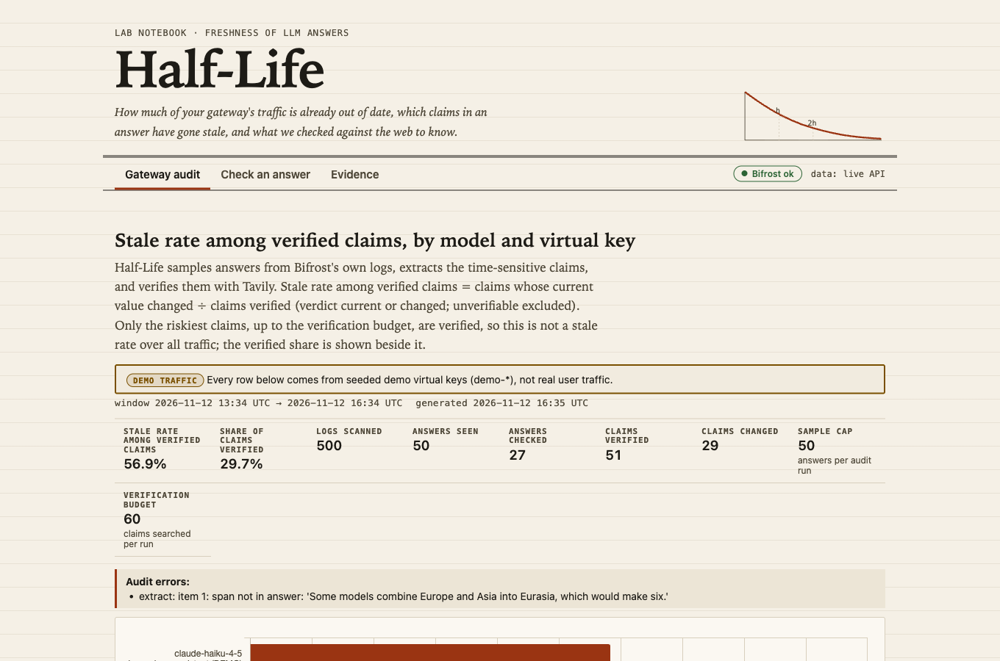
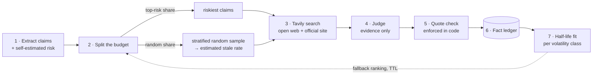
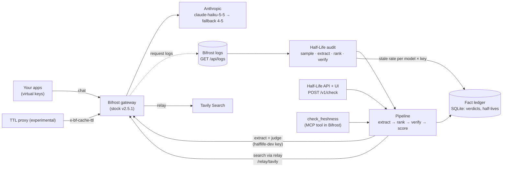

# Half-Life

**Facts decay. Half-Life tells an AI gateway which answers to re-check, and when.**

A [Bifrost](https://github.com/maximhq/bifrost) gateway reports what every request cost, but not whether the answer
it served is still true.



What it does:

- **Audits the traffic Bifrost already logged.** It reads answers through Bifrost's logging API, finds the
  time-sensitive claims in them (prices, versions, office holders, rates, laws), and reports stale rates per model and
  virtual key, plus an estimated stale rate across the sampled answers from a stratified random sample of their
  claims. Stock Bifrost v2.5.1, public APIs only.
- **Binds every verdict to quoted evidence.** Each claim is checked against live Tavily search; the verdict must quote
  the retrieved text verbatim, code checks the quote, and a claim with no verified quote is reported as unverifiable,
  never as current or changed.
- **Ranks checks by risk.** The verification budget goes to the claims the extractor model rates most likely outdated;
  timeless facts and dated past events are never searched.

Support, measured on 108 hand-labelled cases (one annotator, cases pre-screened to facts Tavily could retrieve):

- Detector, post-fix live run: precision **0.854** [0.742, 0.950], recall **0.921** [0.828, 1.000]; it also flags
  13% of current claims as changed, so low true stale rates read high (see Results).
- Stale claims caught when verifying half the claims (mean of the two live runs): **83%** risk-ranked, **69%** random
  among time-sensitive claims (the fair baseline), 47% blind random. Lift over the fair baseline: **+14 points**
  (per-run 95% CIs [+0.02, +0.20] and [+0.06, +0.23]). The half-life ordering adds no measurable lift over it.
- Cost per check: $0.0011 model cost plus 2.8 Tavily credits (about $0.024 in total at Tavily's pay-as-you-go
  price); median 5.9 s, run offline on logged traffic, never on the request path.

Experimental: a **decay-based cache TTL** from fitted per-class half-lives (a software-version answer gets **6.2
days**; fitted half-life 83 days). Experimental because the half-lives are not calibrated (see Limits).

## How it works



1. **Extract + self-estimated risk.** One Claude Haiku call lists the time-sensitive claims as exact spans of the
   answer (any span not found verbatim is discarded) and, in the same call, estimates the probability each claim is
   outdated given the answer's as-of date.
2. **Split the budget.** In the audit, one share of the budget goes to the riskiest claims and the rest to a random
   sample stratified by rank score (4 quantile strata), which gives an estimated stale rate across the sampled answers
   (default 30%; aim for ≥ ~60 random samples, below which the interval undercovers). The sampled answers are the
   newest N in the window, not a random draw of all traffic. Within the top-risk share, claims are verified in order of that probability; the half-life
   P(stale) = 1 − 2^(−age/h) is the fallback when the model gives no estimate. Timeless claims are never searched.
3. **Tavily search.** Two searches per claim through a Bifrost relay — the open web with a recency filter, and the
   claim's official site when one is known — with a disk cache so repeat evidence costs no credits.
4. **Judge.** A second Haiku call labels the claim current, changed or unverifiable from the retrieved text only,
   preferring official, then newer, evidence when sources disagree, and treating evidence as data, never instructions.
5. **Quote check, enforced in code (the guard against hallucinated verdicts).** Every supporting quote must appear
   verbatim in the evidence for the URL it cites, must share a substantive token with the claim, and a corrected value
   is shown only if a verified quote states it; otherwise the verdict falls back to unverifiable.
6. **Fact ledger.** Each verified outcome (claim class, age, changed or not) is stored in SQLite by the gateway audit,
   with the request's model and virtual key, which is where stale rates per slice come from.
7. **Half-life fit.** Per volatility class, a MAP fit over interval-censored outcomes (did it change within `age`?)
   updates the half-life used for fallback ranking and the experimental cache TTL.

## Quickstart (stock Bifrost, base profile, no Redis)

Prerequisites: Python 3.11+, [uv](https://docs.astral.sh/uv/), Node.js 18+ (for `npx`), an Anthropic API key and a
Tavily API key (free tier: 1,000 credits/month).

```bash
git clone https://github.com/shro-2002/halflife.git && cd halflife
cp .env.example .env    # fill ANTHROPIC_API_KEY, TAVILY_API_KEY, BIFROST_ADMIN_USERNAME/PASSWORD, BIFROST_SETUP_TOKEN
                        # (HALFLIFE_CONTACT_URL only for the eval scripts: Wikidata wants a contact URL)
uv sync
make bifrost            # stock Bifrost v2.5.1 via npx on :8088 (BIFROST_PORT), admin auth from .env
make setup              # Anthropic provider, Tavily relay, virtual key "halflife-dev" ($10 budget), fitted half-lives
make api                # Half-Life API + UI on http://localhost:8091 (stays in the foreground; use a
                        # second terminal, or `make api-bg`). Other port: make api PORT_API=<port>
```

Check one answer:

```bash
curl -s localhost:8091/v1/check -H 'Content-Type: application/json' \
  -d '{"answer": "The Bank of England base rate is 5.25%."}' | python3 -m json.tool
```

Audit gateway traffic (seed demo traffic first if your gateway has none):

```bash
uv run python -m halflife.gateway.seed     # ~40 demo requests on two demo keys and two models
uv run python -m halflife.gateway.audit    # writes data/gateway_summary.json; shown in the UI's Gateway tab
```

`make demo` does all of the above in one command. `make test` runs the offline suite (no keys needed).

Optional pieces:
- **Cache-TTL proxy (needs Redis):** `docker compose up -d redis`, then `BIFROST_PORT=8089 scripts/bifrost.sh cache`,
  `BIFROST_PORT=8089 make setup`, `BIFROST_PORT=8089 uv run uvicorn halflife.gateway.proxy:app --port 8093`.
  Bifrost's cache plugin needs a vector store even in exact-match mode; only this proxy needs Redis.
- **MCP tool:** `uv run python -m halflife.gateway.mcp_server --register` serves `check_freshness` and adds it to
  Bifrost's MCP gateway, granted to the demo keys.

## What it looks like

Checking one answer: each claim gets a verdict, a freshness score, the corrected value, and the verbatim evidence
quote with its source, shown apart from the model's reasoning.


The Evidence view (`docs/img/evidence.png`) shows the budget curve and every measured table from `results/`.

## Architecture



Every model call and every search goes through Bifrost, under one virtual key with a $10 budget; evidence is cached
on disk per day so repeat checks cost no credits.

## Requirements map

| Requirement | Where |
|---|---|
| **T1** Claim identification | `halflife/extract.py` (one Haiku call; spans must be exact substrings; tense kept: dated past events do not decay) |
| **T2** Freshness detection (pricing, API versions, laws, leadership) | `halflife/extract.py` volatility classes + `p_outdated_model`; `halflife/risk.py` half-life P(stale) |
| **T3** Live verification | `halflife/verify.py` (two parallel Tavily searches via the Bifrost relay; judge must quote evidence verbatim, checked in code) |
| **T4** Freshness score per claim | `halflife/risk.py::freshness_score` (95 / 80 / 5 / unverified ≤ 50 / estimated; timeless unscored) |
| **B1** Real operator problem | stale rate per model and virtual key: `halflife/gateway/audit.py`; TTL proxy: `halflife/gateway/proxy.py` |
| **B2** Public extension points | logging API (`GET /api/logs`, `/api/logs/{id}`), governance (virtual keys, budgets, relay and MCP grants), Relays, cache headers, MCP gateway — no Go plugin, no fork |
| **B3** Reproducible on standard Bifrost | `scripts/bifrost.sh` (stock `npx @maximhq/bifrost`), `make setup`, `scripts/spike.sh`, `Dockerfile` |
| **B4** Contribution quality | 160 offline tests + live tests (`make test`), CI (`.github/workflows/ci.yml`), `docs/UPSTREAM.md` (filed as [maximhq/bifrost#10039](https://github.com/maximhq/bifrost/issues/10039)), `CONTRIBUTING.md`, Apache-2.0 |

## What Bifrost contributes, what Tavily contributes

**Bifrost** is the platform: it routes every model call (Anthropic provider, `claude-haiku-5-5` with automatic
fallback to `claude-haiku-4-5`), enforces the virtual key's $10 budget, logs every request (which is what the audit
reads), caches with per-request TTLs (which the proxy sets), hosts the Tavily credential behind a **relay** so search
calls are governed and logged under the same virtual key, and serves `check_freshness` through its MCP gateway.

**Tavily** is the evidence: every verdict rests only on text Tavily returned, via an open-web search with a recency
filter and a domain-restricted search on the official site when one is known. 1 credit per basic search.

## Results

All numbers come from files under `results/`; each folder has a README with the protocol and a reproduce command.

**Live detector, 108 labelled cases** (eval date 2026-11-12; 38 stale, 45 current, 25 timeless) —
[summary.json](results/2026-11-12-detector/summary.json), [results README](results/2026-11-12-detector/README.md).
The cases were pre-screened: a case was kept only if a Tavily result stated its current truth verbatim, so recall is
measured on facts Tavily can retrieve. One annotator.

| Run | Precision (95% CI by source URL) | Recall (95% CI) | Current claims flagged as changed |
|---|---|---|---|
| **Run 2, after the bug fix (headline)** | **0.854** [0.742, 0.950] (35/41) | **0.921** [0.828, 1.000] (35/38) | 6 of 45 = 13% [5%, 23%] |
| Run 1, before the fix (shown separately) | 0.841 [0.733, 0.944] | 0.974 [0.912, 1.000] | 7 of 45 = 16% |
| Timeless cases flagged | 0 of 25 in every run | | |

Run 1 predates a bug fix (a "new" value numerically equal to the claimed one, 2.50% vs 2.5%, was not downgraded).
Three further runs used cached evidence only, as a **precision stability check**: precision 0.873 (0.861–0.889);
their recall, 0.842 (0.816–0.868), is a **lower bound**, because the extractor phrases claims slightly differently
each run, and queries never seen before could not be searched
([variance.json](results/2026-11-12-detector/variance.json)). Live and cached-only runs are not averaged together.

**Measurement bias.** The detector flags some current claims as changed (run 2: 6 of 45 current cases, 13%; 6 of the
36 it searched, 17%). A stale rate computed from its labels is therefore biased upward when the true rate is low:
with recall 0.92, traffic that is truly 5% stale would read about 17–20%. The current cases here are deliberately hard
(each is paired with a stale twin), so the false-flag rate on real traffic may be lower; it is not measured.

**Budget ordering** (live runs 1–2; [fair_baseline.json](results/2026-11-12-detector/fair_baseline.json),
`uv run python -m eval.fair_baseline`). Every curve ranks all 108 cases. The fair baseline orders the cases the
extractor marked time-sensitive at random and the rest last, because the product never searches timeless claims or
dated past events; blind random also spends budget on those.

| Ordering | stale caught @25% of claims | @50% of claims |
|---|---|---|
| Haiku outdated-probability (default) | 0.470 (runs 0.462–0.477) | **0.831** (0.821–0.842) |
| Half-life | 0.383 (0.379–0.387) | 0.712 (0.708–0.715) |
| **Random among time-sensitive (fair baseline)** | 0.348 (0.339–0.356) | **0.694** (0.675–0.712) |
| Blind random | 0.239 (0.233–0.246) | 0.474 (0.460–0.487) |

| Lift over the fair baseline | @25%: run 1 / run 2 (95% CI, paired bootstrap by URL) | @50%: run 1 / run 2 |
|---|---|---|
| Haiku outdated-probability | +0.121 [0.032, 0.224] / +0.123 [0.031, 0.222] | +0.109 [0.022, 0.197] / +0.167 [0.055, 0.232] |
| Half-life | +0.023 [−0.071, 0.097] / +0.048 [−0.033, 0.130] | +0.003 [−0.067, 0.065] / +0.033 [−0.027, 0.095] |

The model's ranking adds about 14 points at half budget over the fair baseline (mean of the two runs: 0.831 vs
0.694), not the 36 points blind random suggests. **The half-life ordering shows no measurable lift over the fair
baseline**: every interval spans zero. Run 2's own interval for the model order at 50% is [0.703, 0.938]. Each run's
curves top out at that run's detector recall (0.92 in run 2, 0.97 in run 1).

**The model's own estimate ranks better than the half-life model.** On the time-travel ordering dataset
([results/2026-11-12-ordering](results/2026-11-12-ordering/README.md)), 300-claim sample:

| Ordering | AUC | caught @10% | @25% | @50% |
|---|---|---|---|---|
| Haiku P(outdated), given as-of date | 0.826 | 0.357 [0.303, 0.429] | 0.748 [0.670, 0.836] | 0.980 |
| Half-life (fitted per class) | 0.782 | 0.298 [0.238, 0.356] | 0.655 [0.556, 0.750] | 0.917 |
| Class only / age only / random | 0.696 / 0.606 / 0.499 | | | |

The gap holds on claims dated after the model's knowledge cutoff (0.827 vs 0.773,
[leakage_check.json](results/2026-11-12-ordering/leakage_check.json)), so it is not leakage. On that dataset (no
timeless claims to skip) half-life ordering beats random, age-only and class-only (all 95% CIs exclude zero), which
is why it stays as the fallback and as the basis for TTL — but the product ranks by the model.

**Estimator validation** ([results/2026-11-13-estimator-validation](results/2026-11-13-estimator-validation/README.md)):
on 1,763 time-sensitive claims with known labels (true stale rate 0.206), 95% interval coverage by sample size is
0.47 / 0.74 / 0.89 / 0.945 / 0.945 / 0.97 at 8 / 18 / 30 / 60 / 120 / 240 random samples, so read intervals as
reliable from about 60 samples. The estimator (proportional stratified sampling, stratum-weighted mean) is unbiased
by construction; the simulation agrees (|bias| ≤ 0.004). That says nothing about measurement bias: real labels come
from the detector (see above).

**Gateway audit, seeded demo traffic** ([results/2026-11-13-gateway-audit](results/2026-11-13-gateway-audit/README.md)).
The audit takes the newest 50 answers in the window, extracts their claims, and verifies two sets: the riskiest
claims (top-risk slice) and a stratified random sample of all time-sensitive claims in those answers. The **estimated
stale rate across the sampled answers** was **0.477**, 95% CI [0.369, 0.590] (0.428–0.528 with unverifiable claims
counted all current / all stale). Read it as a property of the seeded question list, not of any real gateway: the 50
answers come from 40 hand-picked questions in `halflife/gateway/seed.py` (28 about time-sensitive facts, 12 timeless)
plus 10 more picked from that list by the J2 end-to-end test (8 time-sensitive, 2 timeless; 36 time-sensitive and
14 timeless questions in all), alternating between two models, one of them `claude-haiku-4-5` with a February 2025
knowledge cutoff, with no retrieval. Population: the 75 time-sensitive claims in those 50 answers (102 of the 177
extracted claims are timeless or dated past events). Claims cluster within answers, and the bootstrap resamples
claims, not answers, so the interval does not cover that clustering, nor the choice of the newest 50 answers. **The
demo budget did not bind**: 120 claims against 75 time-sensitive claims, so 60 of 75 were sampled at random and 63 of
75 (84%) got a verdict; the estimate and the top-risk figure (32 changed of 63 verified, 0.508) are close because the
two sets nearly coincide.

*Stale rate among verified claims* (top-risk slice) = claims with a `changed` verdict ÷ claims verified (verdict
`current` or `changed`; unverifiable excluded). It is not a stale rate over all claims; the verified share is shown
beside it. **Per-model and per-key figures are confounded, not a model comparison**: keys and models received
different questions (the seed alternates them by question index) and each slice has 11–20 verified claims, so the
bars show the pipeline working, not which model is fresher. An earlier run on the same answers
([results/2026-11-12-gateway-audit](results/2026-11-12-gateway-audit/README.md)) measured 0.569 overall with 29.7% of
extracted claims verified.

**Cost per check** ([results/2026-11-12-checks10](results/2026-11-12-checks10/README.md)): 10 answers (17 claims),
**$0.0011 model cost and 2.8 Tavily credits per check**, median latency 5.9 s (max 9.3 s), `reasoning: none` on Haiku
5.5. At Tavily's pay-as-you-go price of $0.008 per credit
([Tavily docs](https://docs.tavily.com/documentation/api-credits), checked 2026-11-14) the credits cost about $0.022,
so a check costs about **$0.024**, roughly 95% of it search; monthly plans price credits at $0.0075–$0.005, and the
free tier gives 1,000 credits a month.

## Limits

- **Latency:** 5.9 s median per full check (extract + search + judge). The audit runs offline on logged traffic;
  the proxy returns the answer first and checks in the background.
- **Calibration is off, so the TTL is experimental.** Predicted vs observed stale rates miss by up to 0.27 per class;
  a 24-month refit did not help, and Haiku's probability is not calibrated either
  ([calibration.json](results/2026-11-12-ordering/calibration.json)). Exponential decay per class is a simplification;
  the starting priors were guesses.
- **Data:** the ordering dataset covers four classes only (office holder, software version, policy rate, timeless) —
  prices and laws are not in it. The labelled set is 108 cases from one annotator; several classes are too thin to
  read alone (product spec 5, rates 12, prices 13, software versions 14). Stale cases' as-of dates are approximate,
  and 22 of 38 stale cases take the former value from annotator notes.
- **Search index lag:** a verdict is only as fresh as Tavily's copy of a page. Named example (2026-11-13): for
  "the latest Node.js LTS is Node 20", an older non-official page led the judge to Node.js 24 although nodejs.org's
  release page (Node.js 26 LTS) was also retrieved. Ordering evidence official-first, then newest, removed the wrong
  value but left no correction; and the same rule picked the official Bank of England explainer, whose indexed copy
  still said 3.75% after the November 2026 rise to 4.0%. Publication dates in the index do not reliably reflect page
  content, so the replay example uses claims that verify correctly today.
- **Judge errors:** the judge can over-read evidence (an announced resignation treated as done); every verdict ships
  its verbatim quote and URL so it can be audited. See [errors.md](results/2026-11-12-detector/errors.md).
- **Rate limiter is per process** (in-memory). Behind several replicas, use a shared store. Setting `HALFLIFE_API_KEY`
  protects programmatic callers, but the bundled UI does not send a key; a public UI relies on the rate limit.
- Demo audit numbers describe seeded demo traffic, not production.

**Future work:** per-entity half-lives (a package or office, not a whole class). The model wins today because it
knows within-class differences — a fast-moving package versus a slow one, an unstable government versus a stable one
— that a single per-class half-life cannot express.

## Existing functionality (checked 2026-11-12)

- **Bifrost** has exact-match and semantic caching with per-request TTL (`x-bf-cache-ttl`), but nothing computes the
  TTL from content. It has no freshness scoring or claim verification.
- **[maximhq/bifrost#9748](https://github.com/maximhq/bifrost/issues/9748)** ("FreshGuard", opened 8 Nov 2026) proposes
  a Go plugin that checks answers inline as they pass through Bifrost, using Tavily via a relay. Half-Life differs:
  it needs no plugin or custom build (stock binary, public APIs only); it audits logged traffic offline and reports
  stale rate per model and virtual key; it spends a verification budget on the riskiest claims with a measured
  risk-coverage curve; and it ties cache TTL to fitted decay. The two are complementary: an inline checker could use
  Half-Life's ranking to decide which claims to check. Filed upstream as
  **[maximhq/bifrost#10039](https://github.com/maximhq/bifrost/issues/10039)** (proposal text:
  [docs/UPSTREAM.md](docs/UPSTREAM.md)).

## AI usage disclosure

- **Built with Claude Code** (Claude Opus 5.5) as the lead agent, with Claude subagents for parallel workers and
  independent verifiers; every design decision and gate was approved by the human author.
- **Inside the product:** Claude Haiku 5.5 (via Bifrost) extracts claims, rates how likely each is outdated, and judges
  claims against Tavily evidence; Claude Haiku 4.5 is the automatic fallback. Verdicts are constrained in code to
  verbatim quotes from retrieved evidence.

Licence: Apache-2.0 (same as Bifrost). Contributing: [CONTRIBUTING.md](CONTRIBUTING.md).
