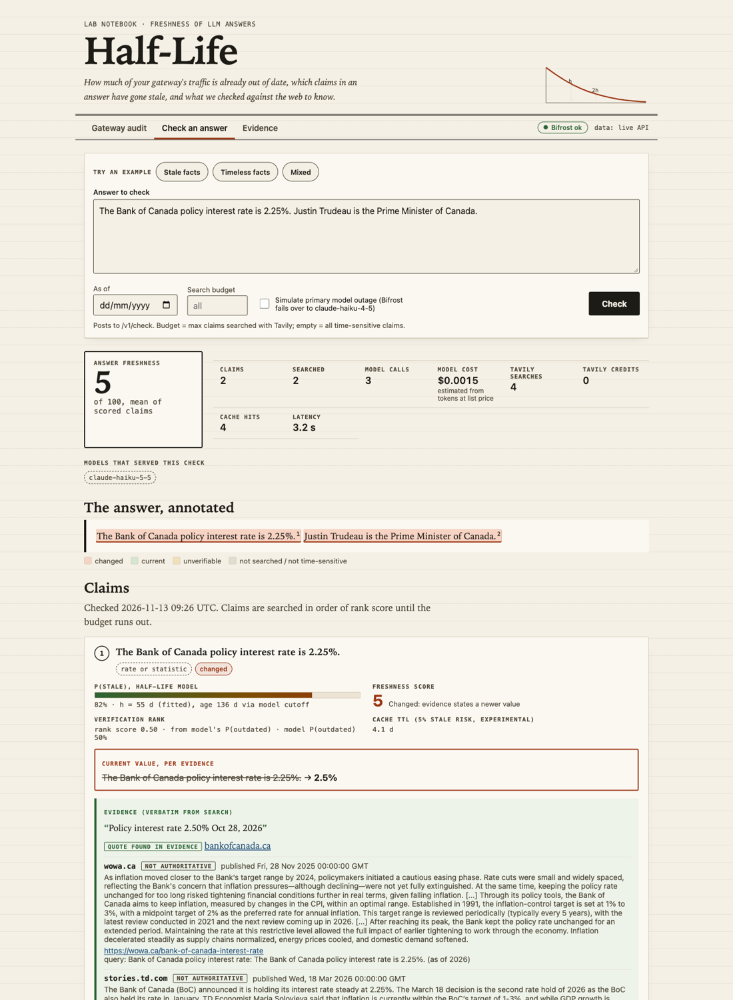
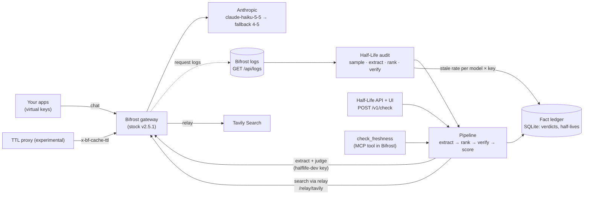

# Half-Life

**Facts decay. Half-Life tells an AI gateway which answers to re-check, and when.**

A [Bifrost](https://github.com/maximhq/bifrost) gateway reports what every request cost, but not whether the answer
it served is still true.

Demo video: <link>


- **Traffic-wide stale-rate estimate:** the audit spends part of its verification budget on a stratified random
  sample of all time-sensitive claims in Bifrost's logged traffic and estimates the stale rate over all of them —
  validated on 1,763 claims with known labels: unbiased at every sample size (|bias| ≤ 0.004) and 95% interval coverage 0.74 at 18 samples, 0.89 at 30, 0.945 at 60 — so aim for about 60 random samples ([validation](results/2026-11-13-estimator-validation/README.md)). On seeded **demo traffic**: **0.477**,
  95% CI [0.369, 0.590]. The interval covers sampling error only: labels come from the detector (live-run precision 0.847, recall 0.948), and the population is the time-sensitive claims the extractor found in the sampled answers (75 of 177 extracted claims here; timeless facts and dated past events cannot go stale and are excluded).
- **Budgeted verification:** claims are ranked by the extractor model's own probability that they are outdated, then
  checked against live Tavily search. Verifying half the claims caught **83%** of the stale ones, against 47% in
  random order (108 labelled cases; mean of the two live runs).
- **Decay-based cache TTL (experimental):** each kind of fact gets a fitted half-life, and the cache TTL is the time
  until P(stale) reaches 5% — a software-version answer gets **6.2 days** (fitted half-life 83 days). Experimental
  because the half-lives are not calibrated (see Limits).

## How it works


1. **Extract + self-estimated risk.** One Claude Haiku call lists the time-sensitive claims as exact spans of the
   answer (any span not found verbatim is discarded) and, in the same call, estimates the probability each claim is
   outdated given the answer's as-of date.
2. **Split the budget.** In the audit, one share of the budget goes to the riskiest claims and the rest to a random
   sample stratified by rank score (4 quantile strata), which gives an unbiased traffic-wide estimate (default 30%;
   aim for ≥ ~60 random samples). Within the top-risk share, claims are verified in order of that probability; the half-life
   P(stale) = 1 − 2^(−age/h) is the fallback when the model gives no estimate. Timeless claims are never searched.
3. **Tavily search.** Two searches per claim through a Bifrost relay — the open web with a recency filter, and the
   claim's official site when one is known — with a disk cache so repeat evidence costs no credits.
4. **Judge.** A second Haiku call labels the claim current, changed or unverifiable from the retrieved text only,
   preferring official, then newer, evidence when sources disagree, and treating evidence as data, never instructions.
5. **Quote check, enforced in code (the guard against hallucinated verdicts).** Every supporting quote must appear
   verbatim in the evidence for the URL it cites, must share a substantive token with the claim, and a corrected value
   is shown only if a verified quote states it; otherwise the verdict falls back to unverifiable.
6. **Fact ledger.** Each verified outcome (claim class, age, changed or not) is stored in SQLite by the gateway audit,
   with the request's model and virtual key, which is where stale rates per slice come from.
7. **Half-life fit.** Per volatility class, a MAP fit over interval-censored outcomes (did it change within `age`?)
   updates the half-life used for fallback ranking and the experimental cache TTL.

## Quickstart (stock Bifrost, base profile, no Redis)

Prerequisites: Python 3.11+, [uv](https://docs.astral.sh/uv/), Node.js 18+ (for `npx`), an Anthropic API key and a
Tavily API key (free tier: 1,000 credits/month).

```bash
git clone https://github.com/shro-2002/halflife.git && cd halflife
cp .env.example .env    # fill ANTHROPIC_API_KEY, TAVILY_API_KEY, BIFROST_ADMIN_USERNAME/PASSWORD, BIFROST_SETUP_TOKEN
                        # (HALFLIFE_CONTACT_URL only for the eval scripts: Wikidata wants a contact URL)
uv sync
make bifrost            # stock Bifrost v2.5.1 via npx on :8088 (BIFROST_PORT), admin auth from .env
make setup              # Anthropic provider, Tavily relay, virtual key "halflife-dev" ($10 budget), fitted half-lives
make api                # Half-Life API + UI on http://localhost:8091 (stays in the foreground; use a
                        # second terminal, or `make api-bg`). Other port: make api PORT_API=<port>
```

Check one answer:

```bash
curl -s localhost:8091/v1/check -H 'Content-Type: application/json' \
  -d '{"answer": "The Bank of England base rate is 5.25%."}' | python3 -m json.tool
```

Audit gateway traffic (seed demo traffic first if your gateway has none):

```bash
uv run python -m halflife.gateway.seed     # ~40 demo requests on two demo keys and two models
uv run python -m halflife.gateway.audit    # writes data/gateway_summary.json; shown in the UI's Gateway tab
```

`make demo` does all of the above in one command. `make test` runs the offline suite (no keys needed).

Optional pieces:
- **Cache-TTL proxy (needs Redis):** `docker compose up -d redis`, then `BIFROST_PORT=8089 scripts/bifrost.sh cache`,
  `BIFROST_PORT=8089 make setup`, `BIFROST_PORT=8089 uv run uvicorn halflife.gateway.proxy:app --port 8093`.
  Bifrost's cache plugin needs a vector store even in exact-match mode; only this proxy needs Redis.
- **MCP tool:** `uv run python -m halflife.gateway.mcp_server --register` serves `check_freshness` and adds it to
  Bifrost's MCP gateway, granted to the demo keys.

## What it looks like

Checking one answer: each claim gets a verdict, a freshness score, the corrected value, and the verbatim evidence
quote with its source, shown apart from the model's reasoning.



The Evidence view (`docs/img/evidence.png`) shows the budget curve and every measured table from `results/`.

## Architecture



Every model call and every search goes through Bifrost, under one virtual key with a $10 budget; evidence is cached
on disk per day so repeat checks cost no credits.

## Requirements map

| Requirement | Where |
|---|---|
| **T1** Claim identification | `halflife/extract.py` (one Haiku call; spans must be exact substrings; tense kept: dated past events do not decay) |
| **T2** Freshness detection (pricing, API versions, laws, leadership) | `halflife/extract.py` volatility classes + `p_outdated_model`; `halflife/risk.py` half-life P(stale) |
| **T3** Live verification | `halflife/verify.py` (two parallel Tavily searches via the Bifrost relay; judge must quote evidence verbatim, checked in code) |
| **T4** Freshness score per claim | `halflife/risk.py::freshness_score` (95 / 80 / 5 / unverified ≤ 50 / estimated; timeless unscored) |
| **B1** Real operator problem | stale rate per model and virtual key: `halflife/gateway/audit.py`; TTL proxy: `halflife/gateway/proxy.py` |
| **B2** Public extension points | logging API (`GET /api/logs`, `/api/logs/{id}`), governance (virtual keys, budgets, relay and MCP grants), Relays, cache headers, MCP gateway — no Go plugin, no fork |
| **B3** Reproducible on standard Bifrost | `scripts/bifrost.sh` (stock `npx @maximhq/bifrost`), `make setup`, `scripts/spike.sh`, `Dockerfile` |
| **B4** Contribution quality | 158 offline tests + live tests (`make test`), CI (`.github/workflows/ci.yml`), `docs/UPSTREAM.md`, `CONTRIBUTING.md`, Apache-2.0 |

## What Bifrost contributes, what Tavily contributes

**Bifrost** is the platform: it routes every model call (Anthropic provider, `claude-haiku-5-5` with automatic
fallback to `claude-haiku-4-5`), enforces the virtual key's $10 budget, logs every request (which is what the audit
reads), caches with per-request TTLs (which the proxy sets), hosts the Tavily credential behind a **relay** so search
calls are governed and logged under the same virtual key, and serves `check_freshness` through its MCP gateway.

**Tavily** is the evidence: every verdict rests only on text Tavily returned, via an open-web search with a recency
filter and a domain-restricted search on the official site when one is known. 1 credit per basic search.

## Results

All numbers come from files under `results/`; each folder has a README with the protocol and a reproduce command.

**Live detector, 108 labelled cases** (eval date 2026-11-12) — [variance.json](results/2026-11-12-detector/variance.json),
[results README](results/2026-11-12-detector/README.md)

| Metric | Live runs 1–2: mean (range) | Run 2 95% CI (by source URL) |
|---|---|---|
| Precision | **0.847** (0.841–0.854) | [0.742, 0.950] |
| Recall | **0.948** (0.921–0.974) | [0.828, 1.000] |
| Timeless cases flagged | 0 of 25 in every run | |

Run 1 predates a bug fix (a "new" value numerically equal to the claimed one, 2.50% vs 2.5%, was not downgraded).
Three further runs used cached evidence only, as a **precision stability check**: precision 0.873 (0.861–0.889);
their recall, 0.842 (0.816–0.868), is a **lower bound**, because the extractor phrases claims slightly differently
each run, and queries never seen before could not be searched. Live and cached-only runs are not averaged together.

| Budget ordering (live runs 1–2) | stale caught @25% of claims | @50% of claims |
|---|---|---|
| Haiku outdated-probability (default) | 0.470 (0.462–0.477) | **0.831** (0.821–0.842) |
| Half-life | 0.383 (0.379–0.387) | 0.712 (0.708–0.715) |
| Random | 0.239 (0.233–0.246) | 0.474 (0.460–0.487) |

**The model's own estimate ranks better than the half-life model.** On the time-travel ordering dataset
([results/2026-11-12-ordering](results/2026-11-12-ordering/README.md)), 300-claim sample:

| Ordering | AUC | caught @10% | @25% | @50% |
|---|---|---|---|---|
| Haiku P(outdated), given as-of date | 0.826 | 0.357 [0.303, 0.429] | 0.748 [0.670, 0.836] | 0.980 |
| Half-life (fitted per class) | 0.782 | 0.298 [0.238, 0.356] | 0.655 [0.556, 0.750] | 0.917 |
| Class only / age only / random | 0.696 / 0.606 / 0.499 | | | |

The gap holds on claims dated after the model's knowledge cutoff (0.827 vs 0.773,
[leakage_check.json](results/2026-11-12-ordering/leakage_check.json)), so it is not leakage. Half-life ordering beats
random, age-only and class-only (all 95% CIs exclude zero), which is why it stays as the fallback and as the basis
for TTL — but the product ranks by the model.

**Traffic-wide estimate.** Validation ([results/2026-11-13-estimator-validation](results/2026-11-13-estimator-validation/README.md)):
on 1,763 time-sensitive claims with known labels (true stale rate 0.206), the stratified estimator is unbiased at every
sample size (|bias| ≤ 0.004); 95% interval coverage is 0.47 / 0.74 / 0.89 / 0.945 / 0.945 / 0.97 at 8 / 18 / 30 / 60 /
120 / 240 samples. On seeded **demo traffic** (50 answers, budget 120 split 50/50, 60 of 75 time-sensitive claims
sampled; [results/2026-11-13-gateway-audit](results/2026-11-13-gateway-audit/README.md)): **0.477**, 95% CI [0.369,
0.590]; 0.428–0.528 with unverifiable claims counted all current / all stale. The interval covers sampling error only: labels come from the detector (live-run precision 0.847, recall 0.948), and the population is the time-sensitive claims the extractor found in the sampled answers. Per-slice estimates have 11–18
samples each and are shown greyed, not reported as findings.

**Gateway audit, top-risk slice, on seeded demo traffic** ([results/2026-11-12-gateway-audit](results/2026-11-12-gateway-audit/README.md)).
*Stale rate among verified claims* = claims with a `changed` verdict ÷ claims verified, where "verified" means the
verdict was `current` or `changed` (unverifiable claims are excluded). The audit verifies only the riskiest claims,
ranked across the run, up to a verification budget, so this is **not** a stale rate over all traffic; the *verified
share* is reported beside it. On 50 seeded demo answers (2 keys × 2 models), this earlier run measured stale rate
among verified claims 0.27–0.78 per slice, 0.569 overall, with 29.7% of all extracted claims verified (that run did not
record the time-sensitive count). In the 2026-11-13 rerun: 32 changed of 63 verified = 0.508, and 63 of the 75
time-sensitive claims (84%) got a verdict; the other 102 of 177 extracted claims are timeless or dated past events.

**Cost per check** ([results/2026-11-12-checks10](results/2026-11-12-checks10/README.md)): 10 multi-claim answers,
$0.0011 and 2.8 Tavily credits per check, median latency 5.9 s (max 9.3 s), `reasoning: none` on Haiku 5.5.

## Limits

- **Latency:** 5.9 s median per full check (extract + search + judge). The audit runs offline on logged traffic;
  the proxy returns the answer first and checks in the background.
- **Calibration is off, so the TTL is experimental.** Predicted vs observed stale rates miss by up to 0.27 per class;
  a 24-month refit did not help, and Haiku's probability is not calibrated either
  ([calibration.json](results/2026-11-12-ordering/calibration.json)). Exponential decay per class is a simplification;
  the starting priors were guesses.
- **Data:** the ordering dataset covers four classes only (office holder, software version, policy rate, timeless) —
  prices and laws are not in it. The labelled set is 108 cases from one annotator; several classes are too thin to
  read alone (product spec 5, rates 12, prices 13, software versions 14). Stale cases' as-of dates are approximate,
  and 22 of 38 stale cases take the former value from annotator notes.
- **Search index lag:** a verdict is only as fresh as Tavily's copy of a page. Named example (2026-11-13): for
  "the latest Node.js LTS is Node 20", an older non-official page led the judge to Node.js 24 although nodejs.org's
  release page (Node.js 26 LTS) was also retrieved. Ordering evidence official-first, then newest, removed the wrong
  value but left no correction; and the same rule picked the official Bank of England explainer, whose indexed copy
  still said 3.75% after the November 2026 rise to 4.0%. Publication dates in the index do not reliably reflect page
  content, so the replay example uses claims that verify correctly today.
- **Judge errors:** the judge can over-read evidence (an announced resignation treated as done); every verdict ships
  its verbatim quote and URL so it can be audited. See [errors.md](results/2026-11-12-detector/errors.md).
- **Rate limiter is per process** (in-memory). Behind several replicas, use a shared store. Setting `HALFLIFE_API_KEY`
  protects programmatic callers, but the bundled UI does not send a key; a public UI relies on the rate limit.
- Demo audit numbers describe seeded demo traffic, not production.

**Future work:** per-entity half-lives (a package or office, not a whole class). The model wins today because it
knows within-class differences — a fast-moving package versus a slow one, an unstable government versus a stable one
— that a single per-class half-life cannot express.

## Existing functionality (checked 2026-11-12)

- **Bifrost** has exact-match and semantic caching with per-request TTL (`x-bf-cache-ttl`), but nothing computes the
  TTL from content. It has no freshness scoring or claim verification.
- **[maximhq/bifrost#9748](https://github.com/maximhq/bifrost/issues/9748)** ("FreshGuard", opened 8 Nov 2026) proposes
  a Go plugin that checks answers inline as they pass through Bifrost, using Tavily via a relay. Half-Life differs:
  it needs no plugin or custom build (stock binary, public APIs only); it audits logged traffic offline and reports
  stale rate per model and virtual key; it spends a verification budget on the riskiest claims with a measured
  risk-coverage curve; and it ties cache TTL to fitted decay. The two are complementary: an inline checker could use
  Half-Life's ranking to decide which claims to check. See [docs/UPSTREAM.md](docs/UPSTREAM.md).

## AI usage disclosure

- **Built with Claude Code** (Claude Opus 5.5) as the lead agent, with Claude subagents for parallel workers and
  independent verifiers; every design decision and gate was approved by the human author.
- **Inside the product:** Claude Haiku 5.5 (via Bifrost) extracts claims, rates how likely each is outdated, and judges
  claims against Tavily evidence; Claude Haiku 4.5 is the automatic fallback. Verdicts are constrained in code to
  verbatim quotes from retrieved evidence.

Licence: Apache-2.0 (same as Bifrost). Contributing: [CONTRIBUTING.md](CONTRIBUTING.md).
